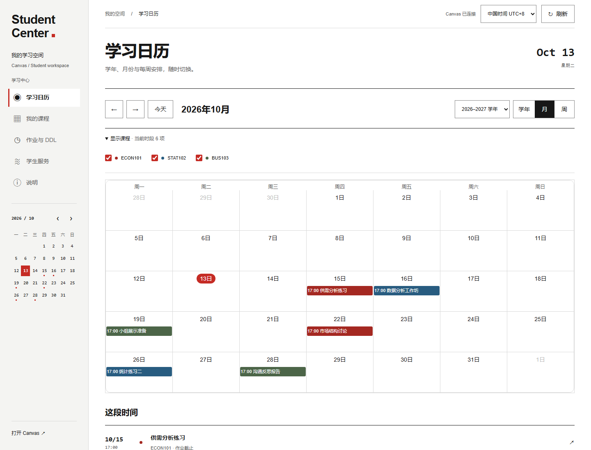
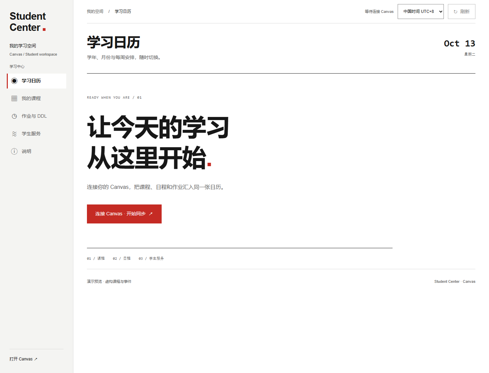
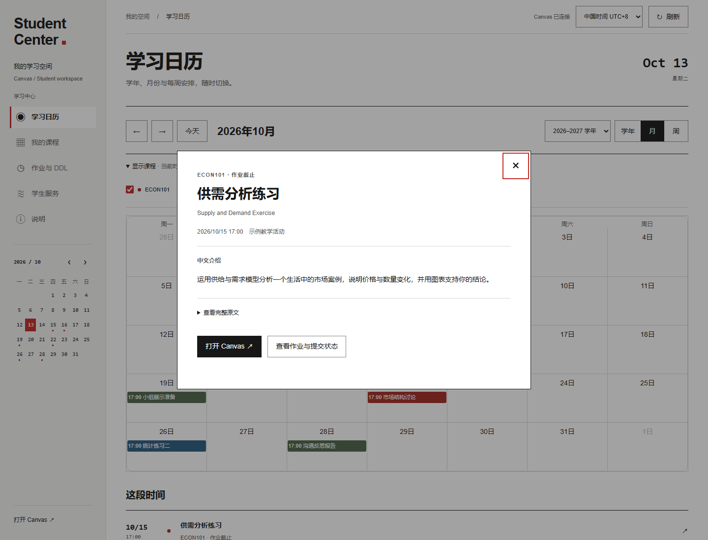
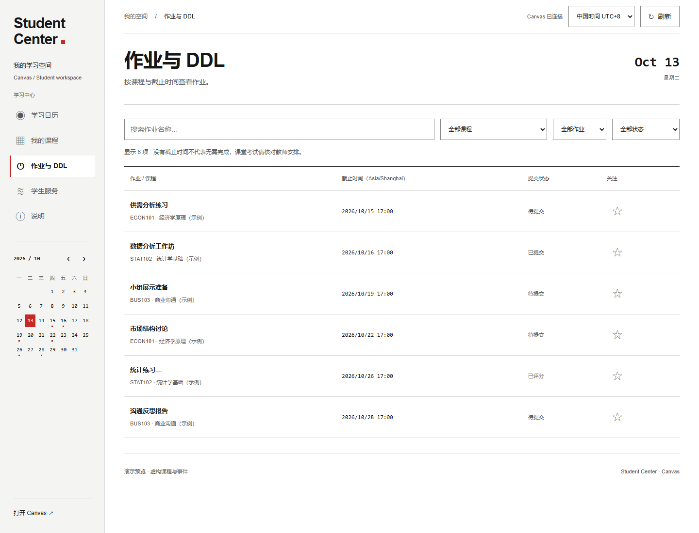
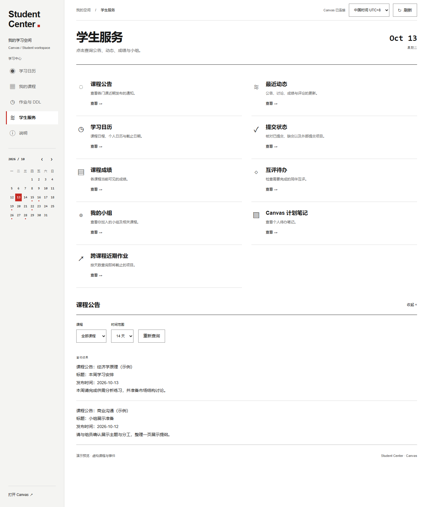

# Canvas & Chaoxing SILC MCP · Student Center

> **状态：Preview（预览阶段）**。本版本用于学生课程助手的先验性实验，验证本地工作台、课程整理与 MCP 工具装配的可行性。功能和接口仍可能调整，尚未作为稳定版本发布。

本地学生课程助手的先验性实验。当前版本实现 **Canvas**；**超星 / Chaoxing 尚未接入**，仓库名称不代表已有超星功能。

## 工作台操作预览

前端 UI 与工作台后端均包含在仓库中：页面、样式、情境光标及日历组件位于 [`static/`](static/)，本地服务入口为 [`app.py`](app.py)。以下图片由当前前端使用虚构课程、作业和公告渲染，不包含真实账号数据。

**学习日历**：连接后进入首页，通过「学年 / 月 / 周」切换视图，勾选课程筛选事件，也可点击侧栏日期快速跳转。



<details>
<summary>连接入口：点击「连接 Canvas · 开始同步」</summary>

先按下方「本地运行」配置环境和自己的 Canvas Token，再点击按钮读取课程、作业和日历。



</details>

<details>
<summary>事件详情：点击日历事件查看中文介绍</summary>

弹窗展示中文介绍、日期和原文入口，可继续查看作业提交状态或打开 Canvas。



</details>

<details>
<summary>作业与 DDL：搜索、筛选和关注</summary>

按课程、截止日期和提交状态筛选，点击作业查看详情，点击星标加入关注。



</details>

<details>
<summary>学生服务：点击查询，通过选择器调整范围</summary>

点击公告、动态、成绩或小组等服务直接查询；课程和时间范围通过选择器调整，结果显示在下方。



</details>

## 当前功能

- 点击连接 Canvas 后读取课程、作业、提交状态和日历，准备后续查询参数。
- 日历为首页：学年（9 月至次年 8 月）、月、周视图；课程勾选筛选、侧栏快速日期跳转和事件详情。
- 作业搜索、课程/状态筛选，详情与 Canvas 原页面入口。
- 中国时间、悉尼时间、UTC；未设置截止时间不会自动判为逾期。
- 收藏和学习计划保存在浏览器 localStorage，不写回 Canvas。
- 公告、动态、小组、成绩等学生服务点击即查询；课程、天数及动态类型通过可视化选择器传入，不需填写技术参数。
- 「学生服务 → 课程成绩」内置目标分数计算器：选择课程，查看作业组权重、已评分作业及当前加权贡献；输入目标总评，测算剩余项目所需得分率。选择只反推 Quiz／考试时，勾选项目并填写其他未评分作业的预计得分率，结果列出每项参考分值。
- 项目说明集中于侧栏“说明”；Swiss 排版与情境光标支持桌面、触屏、键盘及减少动态效果偏好。
- 无内置聊天模型；MCP 可另接到 Codex 等客户端。

## 已装配工具

成绩预测复用固定版本的 Canvas 计算引擎，支持按作业组加权或总分计分，并应用剔除、豁免及不计入总评规则。目标与预计得分率范围为 0–100%；预计值仅用于测算，不写回 Canvas。结果基于当前可见项目，不保证未发布考试、未来规则变更或教师覆盖后的总评；评分周期课程暂不提供跨周期预测。统一得分率是一种可行分数组合，不是每项唯一的分数要求。

上游 `vishalsachdev/canvas-mcp` 固定为 **v1.14.0**，commit `4696c166722becf7608f1f197a0c72c83048d224`。

| 提供者 | 已加载 | 工作台允许调用 |
|---|---:|---:|
| 上游学生＋共享工具 | 47 | 47 个只读工具 |
| 原有精简 Canvas MCP | 5 | 3 个只读工具；2 个教师写工具禁用 |

实际工具名称、说明、输入 Schema 和启用状态见 [`tools/loaded-tools.json`](tools/loaded-tools.json)。加载成功不代表每个工具都已通过学校账号权限验证。

运行时强制 `CANVAS_ROLE=student`、`ALLOWED_WRITE_TOOLS=none`、`STUDENT_WRITE_TOOLS` 为空、`EXECUTE_TYPESCRIPT_ENABLED=false`。上游源码中的其他角色及写工具为保持完整依赖而保留，但本工作台不注册或不放行它们。单独运行 legacy MCP 会暴露其五个工具，请使用工作台的只读入口。

## 本地运行（Windows / Python 3.12）

```powershell
git clone https://github.com/shu-silc-osc/canvas-chaoxing-silc-mcp.git
cd canvas-chaoxing-silc-mcp
python -m pip install uv
.\setup.ps1
```

把自己的 `CANVAS_API_TOKEN` 设置在启动服务的进程环境中，或通过 Windows 用户环境变量界面设置。不要把实际 Token 写入脚本、提交、Issue 或截图。项目中的 `.env.example` 只是空值说明，不会被工作台自动加载。

```powershell
.\start.ps1
# 停止服务
.\stop.ps1
```

地址：`http://127.0.0.1:8768/`。默认实例是 `https://insearch.instructure.com/`；当前适配器限制此 HTTPS 主机，不宣称支持任意学校。服务只监听回环地址，API 校验 Host、Origin 和每次启动生成的会话凭证。关闭网页不会停止服务。

两个 MCP 使用独立虚拟环境，避免 MCP 1.x/2.x 依赖冲突。安装使用各自 `uv.lock`；虚拟环境不在仓库中。

## 接入 MCP 客户端

参照 [`docs/mcp-config.example.toml`](docs/mcp-config.example.toml)，把占位绝对路径替换为克隆路径。Token 由客户端的进程环境继承，不放入配置文件。此文件是示例，不会自动修改本机 Codex 设置。

## 发布内容与签名

- 上传源码、静态页面、工具目录、依赖锁文件、安装脚本和许可证。
- 不上传 Canvas API Key、Cookie、GPG 私钥、真实课程/成绩数据、运行日志、真实账号截图或虚拟环境；README 预览图仅使用虚构演示数据。
- GPG 公钥及指纹见 [`docs/SIGNING.md`](docs/SIGNING.md)；初始提交和版本标签使用 GPG 签名。
- 收藏与计划依赖浏览器本地存储；课程与日历数据在服务进程内缓存约 5 分钟。
- 事件介绍译文按源文本哈希匹配，译文及待翻译队列保存在用户目录的 `StudentCenter` 文件夹，不随源码发布。`baoyu-translate` 为翻译工作流，当前没有常驻翻译模型；新内容或修改后的介绍标为待翻译，并保留完整原文。

## 本地验证

需要 Node.js（内置测试运行器）及完成 `setup.ps1` 后的 Python 环境：

```powershell
node --test tests/*.test.cjs
.\vendor\canvas-mcp\.venv\Scripts\python.exe -m unittest discover -s tests -p 'test_*.py'
```

测试使用虚构数据，不读取真实课程，也不写入 Canvas。

## 来源与许可

上游 Canvas MCP 为 MIT，原版权声明保留于 [`vendor/canvas-mcp/LICENSE`](vendor/canvas-mcp/LICENSE)。来源与版本记录见 [`THIRD_PARTY_NOTICES.md`](THIRD_PARTY_NOTICES.md)。本项目新增代码采用 MIT。

实验版不提供云服务、自动提交或学校官方保证。学校权限可能返回 403 或空内容；课程日期仍以 Canvas 原始记录和教师说明为准。
